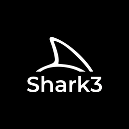

  
  
  <h1>Shark3</h1>
  
<strong>A experiência definitiva e minimalista para criadores e editores.</strong>

  
  

    
    
    
  

  
  

    <i>Feito com orgulho no Brasil 🇧🇷</i>
  

## ✨ Sobre o Projeto

O **Shark3** nasceu de uma necessidade real: ferramentas poderosas não precisam ser complicadas. Desenvolvido para profissionais de mídia, produtores musicais e criadores de conteúdo, nosso foco é entregar uma interface premium, livre de distrações e com performance de ponta.

Nós não acreditamos em softwares inchados. Acreditamos em uma experiência fluida, onde a tecnologia trabalha silenciosamente para você criar o que importa.

## 🚀 Principais Recursos

*   **Interface Minimalista:** Um design escuro, elegante e focado no que realmente importa, projetado para reduzir a fadiga visual durante longas sessões de trabalho.
*   **Equalizador Avançado (EQ):** Controle total sobre o seu áudio. Ajustes precisos, visuais dinâmicos e respostas em tempo real para garantir a melhor qualidade sonora.
*   **Performance Nativa:** Construído com as melhores tecnologias para ser rápido, leve e não engasgar, mesmo em máquinas mais modestas.
*   **Privacidade em Primeiro Lugar:** Sem anúncios, sem rastreamento (telemetry) e sem coleta de dados. O seu trabalho e seus dados são 100% seus.
*   **Workflow Otimizado:** Atalhos inteligentes e uma disposição de tela que faz sentido para quem precisa de agilidade.

---

## 📸 Interface

Dê uma olhada na experiência que preparamos para você.

  <!-- SUBSTITUA OS LINKS ABAIXO PELOS LINKS DAS SUAS IMAGENS -->
  
  &nbsp;&nbsp;
  
   
  Layout Principal &nbsp;•&nbsp; Equalizador Avançado

---

## 📥 Download

A versão mais recente está sempre disponível na aba de **Releases**. 

| Sistema Operacional | Arquitetura | Download |
| :--- | :--- | :--- |
| **Windows** | 64-bit (Intel/AMD) | [Baixar Instalador (.exe)](#) |

*(Nota: Por ser um projeto independente, o Windows pode exibir um aviso de segurança na primeira execução. Basta clicar em "Mais Informações" -> "Executar Assim Mesmo" ou "Abrir Mesmo").*

---

## 🛠️ Construído com

*   [Python ] *
*   [PyInstaller](https://pyinstaller.org/) para empacotamento
*   [Inno Setup](https://jrsoftware.org/isinfo.php) para o instalador do Windows

---

## ⚖️ Licença e Legal

Este é um projeto **Source-Available** (Código Aberto). Sinta-se livre para estudar, modificar e usar para fins pessoais ou acadêmicos. 

A venda ou o empacotamento do Shark3 em produtos comerciais de terceiros não é permitida. O nome e a logo "Shark3" são marcas do autor.

---

  
Design com propósito. Desenvolvido no Brasil 🇧🇷 para o mundo.

  
Se este projeto te ajudou, considere deixar uma ⭐!

