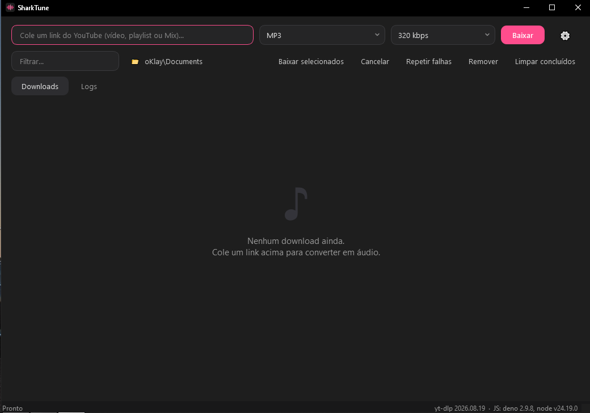
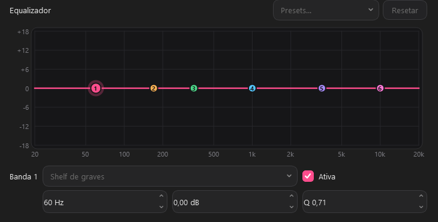

  
  
  <h1>Shark3</h1>
  
<strong>Stop overcomplicating things. The ultimate player for Windows.</strong>

  
  

    
    
  

## ✨ The Shark3 Vibe

You know that app you download, open, and it just **works**? No endless menus, no ads, no dragging your PC down? That's Shark3.

We got tired of bloated, soulless tools. We built Shark3 for people who actually use their computers to work and create: you. A beautiful, dark, straight-to-the-point interface with the performance your Windows deserves. It's simple, it's fast, and it's proudly Brazilian.

## 🚀 What it actually does (The real features)

*   🎚️ **A Real Equalizer (EQ):** Forget basic EQs. You get total control here. Tweak the lows, highs, and mids, and watch the real-time visual feedback. Shape your sound however you want—whether you're editing a video or just vibing to a track.
*   🌑 **Minimalist Design (Always Dark Mode):** A clean, modern, no-nonsense interface. Your eyes will thank you after an 8-hour shift in front of the screen.
*   ⚡ **Lightweight & Fast:** Shark3 won't fry your machine. It's optimized to open instantly and won't eat up the resources you need for other tasks.
*   🛡️ **Total Privacy:** Zero telemetry, zero tracking. Nobody here is watching what you do. What's yours stays on your PC.
*   🪟 **Built for Windows:** No half-measures. Shark3 was engineered and polished exclusively for the Windows ecosystem, ensuring rock-solid stability and seamless integration.

---

## 📸 Take a look at the visuals

  
  &nbsp;&nbsp;
  
   
  Main Layout &nbsp;•&nbsp; Advanced Equalizer

---

## 📥 Download

The latest version is always available in the **Releases** tab.

| Operating System | Architecture | Download |
| :--- | :--- | :--- |
| **Windows** | 64-bit (Intel/AMD) | [Download Installer (.exe)](https://github.com/klayttonggaldino-ship-it/Shark3/releases) |

*(Note: Since we are an independent project, Windows might show a "SmartScreen" warning on the first run. Just click "More info" -> "Run anyway").*

---

## 🛠️ Under the hood

*   **Language:** Python
*   **Packaging:** PyInstaller
*   **Installer:** Inno Setup

---

## ⚖️ License

This is a **Source-Available** project. Feel free to study, modify, and use it for personal and academic purposes. Selling, monetizing, or using the Shark3 brand/logo without permission is not allowed.

---

  
Designed with purpose. Proudly built in Brazil 🇧🇷 for the world.

  
If Shark3 helped you out, drop a ⭐ to show some love!

